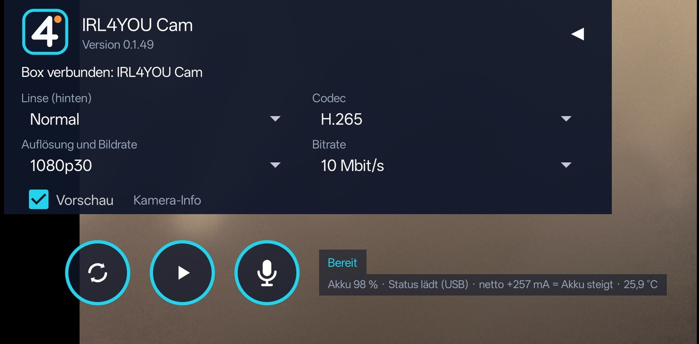
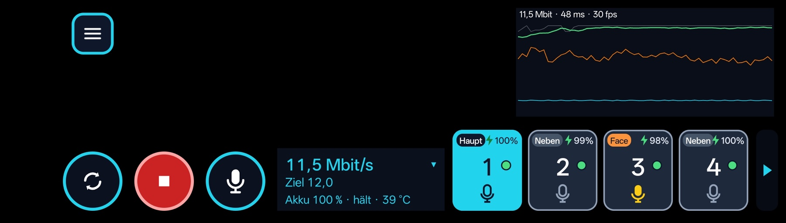
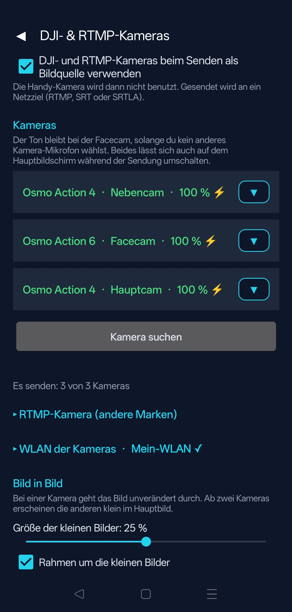
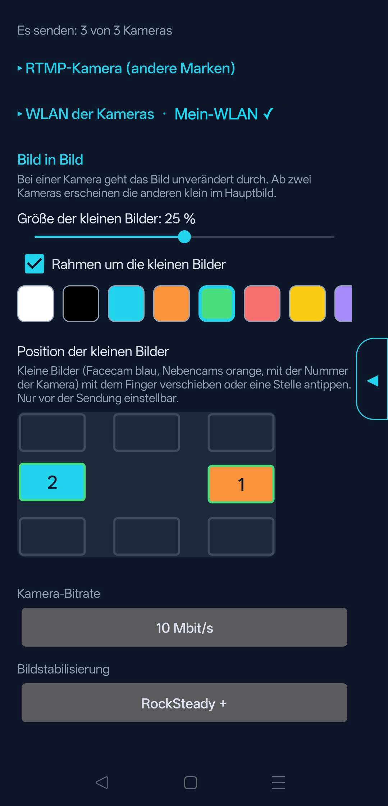
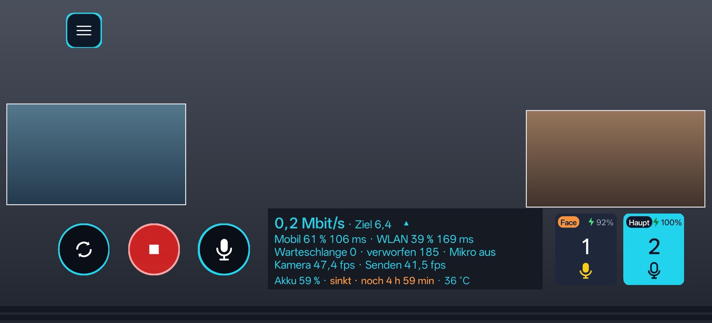
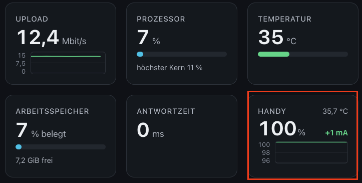

# IRL4YOU Cam, IRL4YOU Cam Net und IRL4YOU Stream Link

**In diesem Repository liegen drei Android-Apps.** Zwei machen dein Android-Handy zur Kamera für die [IRL4YOU BOX](https://github.com/IRL4YOU/IRL4YOU-BOX); IRL4YOU Cam Net kann zusätzlich direkt an Server senden und auch DJI-Kameras und andere RTMP-Kameras als Bildquelle nutzen. Die dritte, IRL4YOU Stream Link, macht ein zweites Handy zum zusätzlichen Sendeweg, entweder für die IRL4YOU BOX oder für IRL4YOU Cam Net. So brauchst du unterwegs weniger Router.
**This repository contains three Android apps.** Two turn your Android phone into a camera for the [IRL4YOU BOX](https://github.com/IRL4YOU/IRL4YOU-BOX); IRL4YOU Cam Net can also send directly to servers and use DJI cameras and other RTMP cameras as the picture source. The third, IRL4YOU Stream Link, turns a second phone into an additional uplink, either for the IRL4YOU BOX or for IRL4YOU Cam Net. That way you need fewer routers on the road.

Mehr dazu auf der Webseite: [irl4you.de](https://irl4you.de/irl4you-cam-apps.html) · More on the website: [irl4you.de](https://irl4you.de/en/irl4you-cam-apps.html)

| |  **IRL4YOU Cam** |  **IRL4YOU Cam Net** |  **IRL4YOU Stream Link** |
|---|---|---|---|
| Download | [`IRL4YOU-Cam.apk`](https://github.com/IRL4YOU/IRL4YOU-Cam/releases/latest/download/IRL4YOU-Cam.apk) | [`IRL4YOU-Cam-Net.apk`](https://github.com/IRL4YOU/IRL4YOU-Cam/releases/latest/download/IRL4YOU-Cam-Net.apk) | [`IRL4YOU-Stream-Link.apk`](https://github.com/IRL4YOU/IRL4YOU-Cam/releases/latest/download/IRL4YOU-Stream-Link.apk) |
| Sendet an / Sends to | IRL4YOU BOX per USB-Kabel / via USB cable | USB-Box und zusätzlich RTMP, RTMPS, SRT, SRTLA / USB box plus RTMP, RTMPS, SRT, SRTLA | reicht den Stream der IRL4YOU BOX oder von IRL4YOU Cam Net über den eigenen Mobilfunk weiter / passes the stream of the IRL4YOU BOX or of IRL4YOU Cam Net on over its own mobile network |
| Bildquelle / Picture source | Handy-Kamera / phone camera | Handy-Kamera oder bis zu drei DJI- und RTMP-Kameras / phone camera or up to three DJI and RTMP cameras | keine / none |
| Internet-Berechtigung / Internet permission | nein / no | ja / yes | ja / yes |
| Gedacht für / Meant for | IRL4YOU Cam, nur mit der BOX / IRL4YOU Cam, BOX only | wer auch an eigene Server oder mehrere Netze senden will, oder DJI-Kameras ohne zusätzliche Box nutzen möchte / for sending to your own servers or over several networks, or for using DJI cameras without an extra box | ein zweites Handy als weiterer Sendeweg für SRTLA an der BOX oder an IRL4YOU Cam Net, ohne Kamera und Mikrofon / a second phone as an additional SRTLA uplink for the BOX or IRL4YOU Cam Net, without camera or microphone |

Alle drei lassen sich nebeneinander installieren (eigene App-Kennung) und haben getrennte Versionsnummern.
All three can be installed side by side (separate app ID) and have separate version numbers.

**Neu: DJI-Kameras als Bildquelle.** IRL4YOU Cam Net verbindet sich per Bluetooth mit DJI-Kameras (getestet: Osmo Action 4 und Osmo Action 6), schickt ihnen das WLAN, startet ihren Livestream und nimmt ihn per RTMP direkt auf dem Handy entgegen. Bis zu drei Kameras werden zu einem Bild zusammengesetzt (Hauptbild und kleine Bilder) und per SRT, SRTLA oder RTMP an deinen Server gesendet. Auch andere Kameras, die RTMP senden, lassen sich einbinden. Siehe „DJI-Kameras und andere RTMP-Kameras“.
**New: DJI cameras as a picture source.** IRL4YOU Cam Net connects to DJI cameras over Bluetooth (tested: Osmo Action 4 and Osmo Action 6), hands them the Wi-Fi, starts their live stream and receives it over RTMP right on the phone. Up to three cameras are combined into one picture (main picture and small pictures) and sent to your server over SRT, SRTLA or RTMP. Other cameras that send RTMP can be added as well. See "DJI cameras and other RTMP cameras".

**Download:** Die Dateinamen in der Tabelle oben laden direkt die aktuelle Version. Alle drei Dateien und die Änderungen stehen unter [Releases](../../releases/latest) (nur Android) / The file names in the table above download the current version directly. All three files and the changes are under [Releases](../../releases/latest) (Android only)

Die Beschreibung unten gilt für IRL4YOU Cam Net; IRL4YOU Cam hat keine Server-Ziele. IRL4YOU Stream Link hat einen eigenen Abschnitt. / The description below covers IRL4YOU Cam Net; IRL4YOU Cam has no server targets. IRL4YOU Stream Link has its own section.

## Screenshots

   
  Bedienfeld / Control panel

   
  Beim Senden / While sending

   
  DJI-Kameras (nur IRL4YOU Cam Net): Rollen, Akku, Bild in Bild / DJI cameras (IRL4YOU Cam Net only): roles, battery, picture-in-picture

   
  Bild in Bild: Größe, Rahmenfarbe und Position der kleinen Bilder / Picture-in-picture: size, frame colour and position of the small pictures

   
  Beim Senden mit Kameras: Umschalter für Hauptbild und Ton (Kamerabilder im Screenshot ersetzt) / Sending with cameras: switcher for main picture and sound (camera pictures replaced in the screenshot)

   
  Anzeige auf der Box: Akku, Temperatur, Laden oder Entladen / Display on the box: battery, temperature, charging or discharging

---

## Deutsch

### Was die App kann

- Bild und Ton des Handys per USB-Kabel an die Box senden, ohne WLAN
- Alternativ per RTMP, RTMPS, SRT oder SRTLA an einen Server senden (zum Beispiel Twitch, YouTube oder ein eigener Server): Adresse im Menü, bei RTMP mit Stream-Key, bei SRT mit Stream-ID, Passphrase (Verschlüsselung) und Latenz; bricht die Verbindung ab, verbindet die App von selbst neu (nur in IRL4YOU Cam Net)
- Statt der Handy-Kamera DJI-Kameras und andere Kameras, die RTMP senden, als Bildquelle nutzen (nur IRL4YOU Cam Net): bis zu drei Kameras gleichzeitig (mehr sind noch nicht möglich), eine als Hauptbild, die anderen als kleine Bilder (Bild in Bild) mit frei wählbarer Stelle und Rahmen; Hauptbild und Ton lassen sich auch während der Sendung umschalten. DJI-Kameras werden per Bluetooth gekoppelt und eingerichtet und senden an das Handy im selben WLAN (zum Beispiel dem Hotspot); getestet mit Osmo Action 4 und Osmo Action 6. Bei Kameras anderer Marken trägst du Server und Stream-Key, die die App anzeigt, in der Kamera ein
- Verbindung weitergeben: Neben jeder Verbindung (Stift) zeigt die App einen QR-Code. Auf dem anderen Handy mit der Kamera-App scannen, der Link öffnet die App und bietet das Übernehmen an. Alternativ den Link kopieren und mit „Verbindung aus Link einfügen“ übernehmen. Der QR-Code wird in der App selbst erzeugt, ohne zusätzliche Bibliothek. Er enthält Adresse und Schlüssel, also nur kurz zeigen
- Einstellungen sichern: Verbindungen und Einstellungen in eine Datei schreiben, mit Passwort verschlüsselt (nur Bordmittel von Android), und auf dem nächsten Handy wiederherstellen (Knöpfe unten auf der Verbindungsseite)
- Mehrere Verbindungen speichern (eigene Seite, je mit Namen und Kurzinfo), eine anhaken und senden; IRL4YOU Cam Net merkt sich Adresse, Key und Netze je Verbindung. Beim Senden bleibt die Verbindungsseite gesperrt, damit nichts Privates auf dem Bildschirm steht
- SRTLA bündelt WLAN, Mobilfunk und ein USB-Netz (Ethernet-Adapter, USB-Router oder USB-Tethering eines zweiten Handys) gleichzeitig zu einem Strom; fällt ein Netz weg, läuft der Strom über die anderen weiter. Je Netz einstellbare Priorität (1 bis 10, wirkt nur bei stabilem Netz), Anzeige von Anteil und Laufzeit je Netz
- Bei SRT und SRTLA passt die App die Videobitrate schnell selbst an Laufzeit und Pakete unterwegs an, senkt bei Einbrüchen sofort und kehrt danach zügig zurück (nie über der gewählten Bitrate); der Ton hat dabei Vorrang vor dem Bild
- Bildschärfe wählbar (Standard oder schärfer, mit weniger oder stärkerer Rauschglättung der Kamera)
- Video als H.264 oder H.265, bis 1080p mit 25, 30, 50 oder 60 Bildern pro Sekunde; in IRL4YOU Cam Net zusätzlich 720p mit 25, 30, 50 oder 60
- Ton als AAC in Stereo oder Mono (vor dem Livegang wählbar), Mikrofon per Knopf stumm schalten; das Menü ist auch im Querformat erreichbar
- Pegelanzeige für den Ton am unteren Bildrand und Lautstärkeregler von −12 bis +24 dB, auch während der Übertragung
- Vollbild: Die Vorschau füllt den ganzen Bildschirm (abschaltbar, gesendet wird immer das volle Bild); die Akkuanzeige zeigt „lädt“ grün und „sinkt“ orange oder rot; die Temperatur färbt sich, sobald das Handy selbst meldet, dass es wegen Hitze drosselt
- Bitrate wählbar, bis 10 Mbit/s (bei RTMP und SRT ab 1 Mbit/s); im Netz senkt die App die Datenrate selbst, wenn es zu langsam wird
- Hintere Linsen einzeln wählen (zum Beispiel Weitwinkel, Normal, Tele), Wechsel auf die Frontkamera, Selfie-Bild auf Wunsch gespiegelt
- Zoomen mit zwei Fingern, über die Linsengrenzen hinweg mit automatischem Linsenwechsel (bei Handys mit Sammelkamera ohne Lücke)
- Handy drehen: Hochkant und Querformat, das Bild an der Box dreht ohne Unterbrechung mit
- Läuft weiter, wenn der Bildschirm ausgeht
- Übersteht einen Neustart der Box oder kurzes Abziehen des Kabels: Die App wartet auf die Box und sendet danach von selbst weiter
- Stopp auch über die Benachrichtigung, wenn man die Leiste von oben herunterzieht; ist die App nur offen, steht dort „Beenden“
- Logs-Knopf: Ereignisse und Kamera-Info lassen sich kopieren oder als Textdatei speichern, zum Beispiel für eine Fehlermeldung
- Oberfläche auf Deutsch und Englisch, je nach Sprache des Handys
- Anzeige für Akkustand, Ladezustand, Strom und Temperatur des Handys, auch auf der Box sichtbar
- Sparsam gebaut: Das Bild kodiert der Video-Encoder des Handys (in der Regel in Hardware) und die Grafikeinheit dreht es, ohne zusätzliche Bibliotheken und mit weniger als 1 MB Größe; den Internetzugriff brauchen nur IRL4YOU Cam Net und IRL4YOU Stream Link

### DJI-Kameras und andere RTMP-Kameras (nur IRL4YOU Cam Net)

- **Was geht:** DJI-Kameras ersetzen die Handy-Kamera als Bildquelle. Die App koppelt die Kamera per Bluetooth, trägt das WLAN ein, startet den Stream und nimmt ihn auf dem Handy entgegen. Getestet sind Osmo Action 4 und Osmo Action 6; weitere Modelle der Action- und Pocket-Reihe sind in der Steuerung vorgesehen, aber nicht getestet
- **Mehrere Kameras:** bis zu drei gleichzeitig. Eine Kamera ist das Hauptbild, die anderen erscheinen klein im Bild (Bild in Bild). Die Facecam und weitere Kameras (Nebencams) setzt du frei an eine Stelle deiner Wahl, auf Wunsch mit Rahmen in einer von acht Farben
- **Umschalten:** Auf dem Hauptbildschirm hat jede Kamera ein Symbol mit Akkustand und Ladeanzeige. Antippen macht sie zum Hauptbild, das Mikrofon im Symbol legt fest, von welcher Kamera der Ton kommt (Standard: die Facecam). Das geht auch während der Sendung
- **Andere Marken:** Kameras, die nur RTMP senden, trägst du mit einem Namen ein und gibst Server und Stream-Key, die die App anzeigt, in der Kamera ein
- **Weiter zum Server:** wie sonst per RTMP, SRT oder SRTLA, mit allen Netzen und der Regelung der Datenrate
- **Dranbleiben:** Bei eingeschalteter Quelle hält ein Dienst mit Benachrichtigung die Verbindung zu den Kameras, auch bei ausgeschaltetem Bildschirm; nach einem Neustart der App (zum Beispiel nach einem Update) verbinden sich zuvor verbundene Kameras von selbst wieder
- **Grenzen:** die Kameras liefern nur H.264 und höchstens 30 Bilder pro Sekunde; es sind höchstens drei Kameras gleichzeitig möglich (mehr ist nicht getestet); Handy und Kameras müssen im selben WLAN sein, zum Beispiel im Hotspot des Handys oder an einem Router
- IRL4YOU Cam ist kein Produkt von DJI und steht in keiner Verbindung zu DJI. Hinweise zu den Projekten, denen die Bluetooth-Steuerung folgt, stehen in [NOTICE.md](NOTICE.md)

### Was die App nicht kann

- Über WLAN oder Mobilfunk geht nur in IRL4YOU Cam Net etwas: RTMP, RTMPS, SRT oder SRTLA; auch DJI- und RTMP-Kameras als Bildquelle gibt es nur dort
- Keine Aufnahme auf dem Handy, keine Filter, keine Effekte, keine Einblendungen (außer den kleinen Kamerabildern)
- Per USB nur mit der IRL4YOU BOX
- H.265 per RTMP nur bei Servern mit Enhanced RTMP; wer sicher gehen will, nimmt H.264
- DJI- und RTMP-Kameras als Bildquelle: nur H.264, höchstens 30 Bilder pro Sekunde, höchstens drei Kameras gleichzeitig
- **Mit VPN (zum Beispiel Tailscale)** schickt Android auch die Net-App durch das VPN, wenn die VPN-App alles umleitet (etwa mit einem Exit-Node). Dann meldet die App „Server antwortet nicht“. Lösung: die App in der VPN-App vom VPN ausnehmen. Bei Tailscale (ab Version 1.70): Profilbild antippen, „App-based split tunneling“ wählen und „IRL4YOU Cam Net“ anhaken. Andere VPN-Apps haben dafür „Split Tunneling“ oder „Apps ausnehmen“. Alternativ das VPN zum Senden ausschalten.
- Dreht man das Handy während einer Übertragung ins Netz zwischen Hoch- und Querformat, ändert sich die Bildgröße, und manche Server verkraften das nicht
- Bei Handys ohne Sammelkamera entsteht beim Zoomen über eine Linsengrenze eine kurze Lücke im Bild
- Bei 50 oder 60 Bildern pro Sekunde im Hochformat schaffen manche Handys weniger
- Fokus und Belichtung laufen automatisch, von Hand einstellen (Antippen) geht noch nicht
- Externes Mikrofon (USB, Kabel, Bluetooth) nur in IRL4YOU Cam Net, im Menü wählbar; IRL4YOU Cam nimmt mit den eingebauten Mikrofonen auf, weil der USB-Anschluss an der Box hängt
- Ist die Box länger als 30 Minuten nicht erreichbar, beendet sich die App

### Gut zu wissen

- Ein USB-Anschluss lädt das Handy oft langsamer, als die Kamera Strom braucht. Der Akku kann trotz Kabel sinken. Besser ist ein USB-Hub mit eigenem Netzteil, der Daten und Ladestrom liefert. Die Strom-Anzeige der App hilft beim Prüfen.
- Das Handy wird bei laufender Kamera warm. Wird es zu warm, zuerst die Vorschau ausschalten: Gesendet wird weiter, aber Grafik und Display haben weniger zu tun. Reicht das nicht, 30 statt 60 Bilder pro Sekunde wählen. Nicht jedes Handy schafft 60 Bilder auf Dauer. Die Temperaturanzeige färbt sich, sobald das Handy selbst meldet, dass es drosselt. Für längere Streams zusätzlich für Kühlung sorgen.
- Liefert Android bei einem Handy nur einen Mikrofonkanal, sendet die App denselben Ton auf beiden Seiten.
- DJI-Kameras: Drei Kameras zu empfangen, zusammenzusetzen und neu zu kodieren kostet Rechenleistung und Akku. Ein Handy am Netzteil oder an einer Powerbank hilft; wird es warm, die Vorschau ausschalten.
- Voraussetzung: Android 8.0 oder neuer und eine IRL4YOU BOX ab Version 0.5.142 (für den Betrieb ohne Box, mit DJI-Kameras oder Servern, genügt Android 8.0).

### Stream Link: zweites Handy als weiteres Netz

- Die App **IRL4YOU Stream Link** läuft auf einem zweiten Android-Handy (ab Android 8.0). Sie reicht den Stream über den Mobilfunk dieses Handys weiter; für SRTLA ist das ein weiterer Sendeweg, ohne dass ein zusätzlicher Router mit SIM-Karte nötig ist. Sie funktioniert **mit der IRL4YOU BOX und mit IRL4YOU Cam Net**
- Sender (BOX oder Handy) und Hilfshandy müssen im selben Netz sein (Router, WLAN oder Hotspot), das Hilfshandy braucht mobile Daten
- Hilfshandy: `IRL4YOU-Stream-Link.apk` installieren, Passwort festlegen und „Start“ drücken. Die App läuft im Hintergrund weiter, das Handy bleibt für anderes frei
- **IRL4YOU BOX:** In der Oberfläche unter Netzwerk > Stream Link den Schalter „Zweites Handy als zusätzlichen Sendeweg nutzen“ einschalten und dasselbe Passwort eintragen. Die Box findet das Hilfshandy von selbst; es sendet dann als weiterer Weg mit. Nötig ist eine aktuelle Version der BOX
- Sendehandy (IRL4YOU Cam Net): SRTLA wählen, „Stream Link“ anhaken und dasselbe Passwort eintragen. Die App findet das Hilfshandy von selbst und zeigt es als Netz „Link“
- IRL4YOU Stream Link braucht weder Kamera noch Mikrofon. Das Passwort wird nicht übertragen; ändere das voreingestellte Passwort, wenn du ein fremdes WLAN benutzt
- **iPhone-Hotspot:** Auch dort läuft es. Der Hotspot gibt Android-Handys oft keine IPv4-Adresse und lässt sie nur über IPv6 miteinander reden; IRL4YOU Stream Link sucht deshalb zusätzlich per IPv6 und nutzt es automatisch, es muss nichts eingetragen werden. Ob es klappt, hängt vom Hotspot ab. In IRL4YOU Stream Link zeigt die Zeile „Adresse dieses Handys“ alle Adressen des WLANs

### Installation

1. Auf dem Handy die [Releases](../../releases/latest) öffnen und `IRL4YOU-Cam.apk` herunterladen. Für DJI- und RTMP-Kameras sowie zum Senden an Server nimmst du stattdessen `IRL4YOU-Cam-Net.apk`.
2. Die heruntergeladene Datei öffnen. Android fragt, ob Installationen aus dieser Quelle (zum Beispiel dem Browser) erlaubt sind. Einmal erlauben, dann „Installieren“ tippen.
3. App „IRL4YOU Cam“ starten und die Berechtigungen für Kamera, Mikrofon und Benachrichtigungen erlauben. Die Benachrichtigung braucht Android, damit die App im Hintergrund weitersenden darf. Für DJI-Kameras kommen Bluetooth (Geräte in der Nähe) und Standort dazu; der Standort dient nur dazu, WLAN-Namen zu lesen und zu suchen.
4. Updates: neue APK herunterladen und einfach über die alte installieren. Einstellungen bleiben erhalten.

### So benutzt du die App

1. Das Handy per USB-Kabel mit der IRL4YOU BOX verbinden. Das Kabel muss Daten übertragen, ein reines Ladekabel reicht nicht. Besser ist ein Hub mit eigenem Netzteil.
2. Android fragt, ob die App auf das USB-Gerät zugreifen darf. Erlauben.
3. In der App Linse, Codec, Bildrate und Bitrate wählen. Mit dem Start-Knopf unten beginnt die Übertragung. Das Bedienfeld klappt dann weg, das Bild bleibt.
4. Die Box zeigt das Handy als Kamera. Dort wählst du es wie jede andere Kamera aus.
5. Mit zwei Fingern zoomen, mit dem Umschalt-Symbol zwischen vorderer und hinterer Kamera wechseln, mit dem Mikrofon-Knopf den Ton stumm schalten. Mit Stopp beendest du die Übertragung.

**Mit DJI-Kameras (IRL4YOU Cam Net):**

1. Im Menü „DJI- & RTMP-Kameras“ öffnen und den Haken „DJI- und RTMP-Kameras beim Senden als Bildquelle verwenden“ setzen.
2. Unter „WLAN der Kameras“ das WLAN wählen, in dem Handy und Kameras sein sollen (suchen oder eintragen), und speichern. Das Passwort wird einmal eingetragen, die App merkt es sich.
3. Kamera einschalten, „Kamera suchen“ tippen, die Kamera antippen und „Verbinden“ wählen. Bei der ersten Kopplung fragt die Kamera eventuell nach einer Bestätigung.
4. Hauptcam, Facecam und Ton festlegen, Stelle und Rahmen der kleinen Bilder einstellen.
5. Im Menü unter „Verbindungen“ ein Ziel wählen und mit dem Start-Knopf senden.

### Wofür sie gut ist

- Das Handy als Hauptkamera oder als zweite Kamera für Live-Streams mit der IRL4YOU BOX, zum Beispiel unterwegs oder am Einsatzort
- Gute Handykamera mit mehreren Linsen statt einer teuren Zusatzkamera nutzen
- Hochkant oder Querformat, je nach Stream
- Ton direkt vom Handy-Mikrofon mitsenden
- Mehrere DJI-Kameras (zum Beispiel Action-Kameras am Körper oder am Fahrzeug) zu einem Bild zusammenführen und live senden, ohne zusätzlichen Computer oder Box

---

## English

### What the app does

- Sends the phone's video and audio to the box over a USB cable, without Wi-Fi
- Alternatively sends over RTMP, RTMPS, SRT or SRTLA to a server (for example Twitch, YouTube or your own server): address in the menu, with a stream key for RTMP, with stream ID, passphrase (encryption) and latency for SRT; if the connection drops, the app reconnects by itself (IRL4YOU Cam Net only)
- Use DJI cameras and other cameras that send RTMP as the picture source instead of the phone camera (IRL4YOU Cam Net only): up to three cameras at once (more is not possible yet), one as the main picture and the others as small pictures (picture in picture) with a freely chosen position and frame; main picture and sound can also be switched while sending. DJI cameras are paired and set up over Bluetooth and send to the phone in the same Wi-Fi (for example its hotspot); tested with Osmo Action 4 and Osmo Action 6. For cameras of other brands you enter the server and stream key shown by the app in the camera
- Share a connection: next to each connection (pencil) the app shows a QR code. Scan it with the camera app of the other phone, the link opens the app and offers to add it. Alternatively copy the link and use "Verbindung aus Link einfügen" (paste connection from link). The QR code is generated inside the app, with no additional library. It contains address and key, so show it only briefly
- Back up settings: write connections and settings to one file, encrypted with a password (Android built-ins only), and restore them on the next phone (buttons at the bottom of the connections page)
- Save several connections (own page, each with a name and a short summary), tick one and send; IRL4YOU Cam Net remembers address, key and networks per connection. While sending, the connections page stays locked so nothing private is on screen
- SRTLA bonds Wi-Fi, mobile data and a USB network (Ethernet adapter, USB router or USB tethering from a second phone) into one stream; if one network drops, the stream continues over the others. Priority per network (1 to 10, only effective while the network is stable), share and round-trip time per network shown
- With SRT and SRTLA the app quickly adapts the video bitrate itself to round-trip time and packets in flight, drops at once on a dip and returns fast afterwards (never above the chosen bitrate); audio takes priority over video
- Selectable picture sharpness (standard or sharper, with less or stronger camera noise smoothing)
- Video as H.264 or H.265, up to 1080p at 25, 30, 50 or 60 frames per second; IRL4YOU Cam Net also offers 720p at 25, 30, 50 or 60
- Audio as AAC in stereo or mono (selectable before going live), microphone can be muted with a button; the menu is also reachable in landscape
- Level meter for the sound at the bottom edge of the picture and a volume control from −12 to +24 dB, also while streaming
- Full screen: the preview fills the whole screen (can be switched off, the full picture is always sent); the battery display shows “charging” in green and “falling” in orange or red; the temperature is coloured as soon as the phone itself reports that it is throttling because of heat
- Selectable bitrate, up to 10 Mbit/s (from 1 Mbit/s with RTMP and SRT); over the network the app lowers the data rate by itself when it is too slow
- Choose rear lenses individually (for example wide, normal, tele), switch to the front camera, selfie image mirrored if wanted
- Pinch to zoom, with automatic lens switching across lens boundaries (no gap on phones with a logical multi-camera)
- Rotate the phone: portrait and landscape, the picture on the box rotates without interruption
- Keeps running when the screen turns off
- Survives a restart of the box or briefly unplugging the cable: the app waits for the box and then keeps sending by itself
- Stop also from the notification when you pull the shade down; while the app is only open it offers "Quit"
- Logs button: events and camera info can be copied or saved as a text file, for example for a bug report
- Interface in German and English, depending on the phone's language
- Shows battery level, charging state, current and temperature of the phone, also visible on the box
- Built to be frugal: the picture is encoded by the phone's video encoder (usually in hardware) and rotated by the graphics unit, with no additional libraries and a size below 1 MB; only IRL4YOU Cam Net and IRL4YOU Stream Link need internet access

### DJI cameras and other RTMP cameras (IRL4YOU Cam Net only)

- **What works:** DJI cameras replace the phone camera as the picture source. The app pairs the camera over Bluetooth, enters the Wi-Fi, starts the stream and receives it on the phone. Tested: Osmo Action 4 and Osmo Action 6; other models of the Action and Pocket series are provided for in the control but not tested
- **Several cameras:** up to three at once. One camera is the main picture, the others appear small in the picture (picture in picture). You place the facecam and further cameras (side cams) freely at a spot of your choice, with a frame in one of eight colours if you like
- **Switching:** on the main screen each camera has a symbol with battery level and charging indicator. Tapping it makes it the main picture, the microphone in the symbol sets which camera the sound comes from (default: the facecam). This also works while sending
- **Other brands:** cameras that only send RTMP are added with a name, and you enter the server and stream key shown by the app in the camera
- **On to the server:** as usual over RTMP, SRT or SRTLA, with all networks and the bitrate regulation
- **Staying connected:** with the source switched on, a service with a notification keeps the connection to the cameras, even with the screen off; after the app restarts (for example after an update), cameras that were connected before reconnect on their own
- **Limits:** the cameras deliver H.264 only and at most 30 frames per second; at most three cameras at the same time are possible (more is not tested); phone and cameras must be in the same Wi-Fi, for example the phone's hotspot or a router
- IRL4YOU Cam is not a DJI product and is not affiliated with DJI. Notes on the projects the Bluetooth control follows are in [NOTICE.md](NOTICE.md)

### What the app does not do

- Over Wi-Fi or mobile data only IRL4YOU Cam Net does something: RTMP, RTMPS, SRT or SRTLA; DJI and RTMP cameras as a picture source are only there as well
- No recording on the phone, no filters, no effects, no overlays (except the small camera pictures)
- Over USB it works only with the IRL4YOU BOX
- H.265 over RTMP only with servers that support Enhanced RTMP; choose H.264 to be safe
- DJI and RTMP cameras as the picture source: H.264 only, at most 30 frames per second, at most three cameras at the same time
- **With a VPN (for example Tailscale)** Android also sends the Net app through the VPN when the VPN app redirects everything (for example with an exit node). The app then reports "Server antwortet nicht" (server does not answer). Fix: exclude the app from the VPN in the VPN app. With Tailscale (version 1.70 or later): tap your profile picture, choose "App-based split tunneling" and tick "IRL4YOU Cam Net". Other VPN apps call this "split tunneling" or "exclude apps". Alternatively turn the VPN off while sending.
- Rotating the phone between portrait and landscape during a stream over the network changes the picture size, and some servers cannot handle that
- On phones without a logical multi-camera, zooming across a lens boundary causes a short gap in the picture
- At 50 or 60 frames per second in portrait, some phones deliver fewer
- Focus and exposure are automatic, setting them by hand (tap) is not possible yet
- External microphone (USB, cable, Bluetooth) only in IRL4YOU Cam Net, selectable in the menu; IRL4YOU Cam records with the built-in microphones because the USB port is used for the box
- If the box is not reachable for more than 30 minutes, the app quits

### Good to know

- A USB port often charges the phone more slowly than the camera uses power. The battery can drop even with the cable plugged in. A USB hub with its own power supply that provides data and charging current works better. The app's current display helps to check this.
- The phone gets warm while the camera runs. If it gets too warm, switch off the preview first: the stream goes on, but graphics and display have less to do. If that is not enough, choose 30 instead of 60 frames per second. Not every phone can keep up 60 frames for long. The temperature display is coloured as soon as the phone itself reports that it is throttling. For longer streams, provide extra cooling as well.
- If Android delivers only one microphone channel on a phone, the app sends the same sound on both sides.
- DJI cameras: receiving three cameras, compositing and re-encoding them costs processing power and battery. A phone on a charger or a power bank helps; if it gets warm, switch the preview off.
- Requires Android 8.0 or newer and an IRL4YOU BOX version 0.5.142 or later (for use without the box, with DJI cameras or servers, Android 8.0 is enough).

### Stream Link: a second phone as an extra network

- The app **IRL4YOU Stream Link** runs on a second Android phone (Android 8.0 or newer). It passes the stream on over that phone's mobile network; for SRTLA this is an additional uplink without needing another router with a SIM card. It works **with the IRL4YOU BOX and with IRL4YOU Cam Net**
- The sender (BOX or phone) and the helper phone must be in the same network (router, Wi-Fi or hotspot), the helper phone needs mobile data
- Helper phone: install `IRL4YOU-Stream-Link.apk`, set a password and tap "Start". The app keeps running in the background, the phone stays free for other things
- **IRL4YOU BOX:** in the interface under Network > Stream Link switch on "Use a second phone as an additional uplink" and enter the same password. The box finds the helper phone by itself and it then sends as one more path. A current version of the BOX is required
- Sending phone (IRL4YOU Cam Net): choose SRTLA, tick "Stream Link" and enter the same password. The app finds the helper phone by itself and shows it as the network "Link"
- IRL4YOU Stream Link needs neither camera nor microphone. The password is never transmitted; change the preset password when you use a Wi-Fi that is not your own
- **iPhone hotspot:** It works there too. The hotspot often gives Android phones no IPv4 address and lets them talk to each other over IPv6 only; IRL4YOU Stream Link therefore also searches over IPv6 and uses it automatically, nothing has to be entered. Whether it works depends on the hotspot. In IRL4YOU Stream Link the line "Address of this phone" shows all addresses of the Wi-Fi

### Installation

1. On the phone, open the [Releases](../../releases/latest) and download `IRL4YOU-Cam.apk`. For DJI and RTMP cameras and for sending to servers, take `IRL4YOU-Cam-Net.apk` instead.
2. Open the downloaded file. Android asks whether installs from this source (for example the browser) are allowed. Allow it once, then tap "Install".
3. Start the app "IRL4YOU Cam" and allow the permissions for camera, microphone and notifications. Android needs the notification so the app may keep sending in the background. For DJI cameras, Bluetooth (nearby devices) and location are added; location is only used to read and search Wi-Fi names.
4. Updates: download the new APK and install it over the old one. Settings are kept.

### How to use the app

1. Connect the phone to the IRL4YOU BOX with a USB cable. The cable must carry data, a charge-only cable is not enough. A hub with its own power supply is better.
2. Android asks whether the app may access the USB device. Allow it.
3. In the app choose lens, codec, frame rate and bitrate. The start button at the bottom begins the stream. The panel then folds away, the picture stays.
4. The box shows the phone as a camera. You select it there like any other camera.
5. Pinch with two fingers to zoom, use the switch icon to change between front and rear camera, use the microphone button to mute. Stop ends the stream.

**With DJI cameras (IRL4YOU Cam Net):**

1. Open "DJI & RTMP cameras" in the menu and tick "Use DJI/RTMP cameras as the picture source when sending".
2. Under "Wi-Fi for the cameras" choose the Wi-Fi that phone and cameras should be in (search or enter) and save. The password is entered once, the app remembers it.
3. Switch the camera on, tap "Find camera", tap the camera and choose "Connect". On first pairing the camera may ask for confirmation.
4. Set main cam, facecam and sound, and adjust position and frame of the small pictures.
5. In the menu under "Connections" choose a destination and send with the start button.

### What it is good for

- The phone as main camera or second camera for live streams with the IRL4YOU BOX, for example on the road or on location
- Use a good multi-lens phone camera instead of an expensive extra camera
- Portrait or landscape, depending on the stream
- Send the sound from the phone's microphone along
- Combine several DJI cameras (for example action cameras on the body or on a vehicle) into one picture and send it live, without an extra computer or box

---

## Hinweis zu KI

Dieses Projekt entsteht mit Unterstützung von KI. Wir testen auf echten Geräten, nicht jede Zeile wird aber von Hand geprüft. Bitte vor dem Livebetrieb kurz selbst ausprobieren.

## Note on AI

This project is made with the support of AI. We test on real devices, but not every line is reviewed by hand. Please try it out yourself briefly before going live.

---

[Nutzungslizenz / License](LICENSE.md) · [Datenschutz / Privacy](DATENSCHUTZ.md)

© 2026 IRL4YOU
