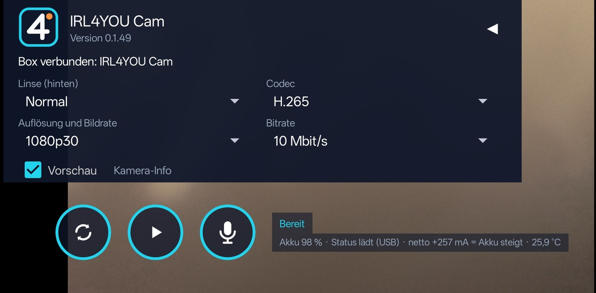
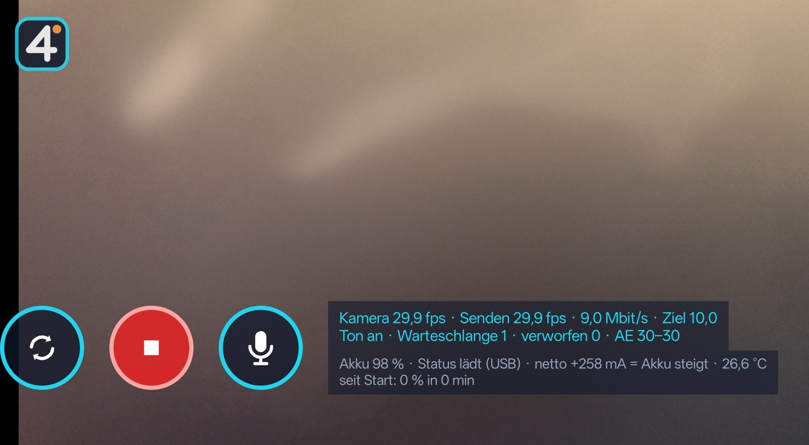
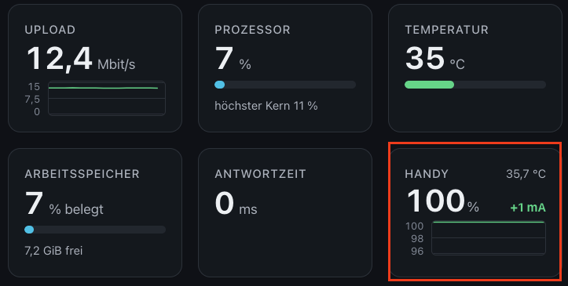

# IRL4YOU Cam

**Android-App:** Dein Android-Handy als Kamera für die [IRL4YOU BOX](https://github.com/IRL4YOU/IRL4YOU-BOX), per USB-Kabel.
**Android app:** Use your Android phone as a camera for the [IRL4YOU BOX](https://github.com/IRL4YOU/IRL4YOU-BOX) over a USB cable.

IRL4YOU Cam ist **für die IRL4YOU BOX** gedacht, die Net-Fassung sendet zusätzlich an eigene Server. Beide sind noch frühe Testversionen.
IRL4YOU Cam is intended **for the IRL4YOU BOX**; the Net version also sends to your own servers. Both are still early test versions.

**Download:** [Releases](../../releases/latest) (`IRL4YOU-Cam.apk` und `IRL4YOU-Cam-Net.apk`, nur Android / Android only)

**Zwei Fassungen / Two versions:**
- **IRL4YOU Cam** (`IRL4YOU-Cam.apk`): nur USB zur Box, ohne Internet-Berechtigung, die kleine einfache Fassung. / USB to the box only, no internet permission, the small simple version.
- **IRL4YOU Cam Net** (`IRL4YOU-Cam-Net.apk`): kann zusätzlich RTMP, SRT und SRTLA (und weiterhin USB). Eigene App-Kennung, beide lassen sich nebeneinander installieren. / Adds RTMP, SRT and SRTLA (and still USB). Separate app ID, both can be installed side by side.

Die Beschreibung unten gilt für die Net-Fassung; die einfache hat keine Server-Ziele. / The description below covers the Net version; the simple one has no server targets.

## Screenshots

   
  Bedienfeld / Control panel

   
  Beim Senden / While sending

   
  Anzeige auf der Box: Akku, Temperatur, Laden oder Entladen / Display on the box: battery, temperature, charging or discharging

---

## Deutsch

### Was die App kann

- Bild und Ton des Handys per USB-Kabel an die Box senden, ohne WLAN
- Alternativ per RTMP, RTMPS, SRT oder SRTLA an einen Server senden (zum Beispiel Twitch, YouTube oder ein eigener Server): Adresse im Menü, bei RTMP mit Stream-Key, bei SRT mit Stream-ID, Passphrase (Verschlüsselung) und Latenz; bricht die Verbindung ab, verbindet die App von selbst neu (nur in der Net-Fassung)
- Mehrere Verbindungen speichern (je mit eigenem Namen und Kurzinfo in der Liste), eine anhaken und senden; die Net-Fassung merkt sich Adresse, Key und Netze je Verbindung
- SRTLA bündelt WLAN, Mobilfunk und ein USB-Netz (Ethernet-Adapter, USB-Router oder USB-Tethering eines zweiten Handys) gleichzeitig zu einem Strom; fällt ein Netz weg, läuft der Strom über die anderen weiter. Je Netz einstellbare Priorität (1 bis 10, wirkt nur bei stabilem Netz), Anzeige von Anteil und Laufzeit je Netz
- Bei SRT und SRTLA passt die App die Videobitrate selbst an die Laufzeit und die Zahl der Pakete unterwegs an (nie über der gewählten Bitrate)
- Video als H.264 oder H.265, bis 1080p mit 25, 30, 50 oder 60 Bildern pro Sekunde
- Ton als AAC in Stereo oder Mono (vor dem Livegang wählbar), Mikrofon per Knopf stumm schalten
- Pegelanzeige für den Ton am unteren Bildrand und Lautstärkeregler von −12 bis +24 dB, auch während der Übertragung
- Bitrate wählbar, bis 10 Mbit/s (bei RTMP und SRT ab 1 Mbit/s); im Netz senkt die App die Datenrate selbst, wenn es zu langsam wird
- Hintere Linsen einzeln wählen (zum Beispiel Weitwinkel, Normal, Tele), Wechsel auf die Frontkamera, Selfie-Bild auf Wunsch gespiegelt
- Zoomen mit zwei Fingern, über die Linsengrenzen hinweg mit automatischem Linsenwechsel (bei Handys mit Sammelkamera ohne Lücke)
- Handy drehen: Hochkant und Querformat, das Bild an der Box dreht ohne Unterbrechung mit
- Läuft weiter, wenn der Bildschirm ausgeht
- Übersteht einen Neustart der Box oder kurzes Abziehen des Kabels: Die App wartet auf die Box und sendet danach von selbst weiter
- Stopp auch über die Benachrichtigung, wenn man die Leiste von oben herunterzieht; ist die App nur offen, steht dort „Beenden“
- Logs-Knopf: Ereignisse und Kamera-Info lassen sich kopieren, zum Beispiel für eine Fehlermeldung
- Oberfläche auf Deutsch und Englisch, je nach Sprache des Handys
- Anzeige für Akkustand, Ladezustand, Strom und Temperatur des Handys, auch auf der Box sichtbar
- Sparsam gebaut: Das Bild kodiert der Video-Encoder des Handys (in der Regel in Hardware) und die Grafikeinheit dreht es, ohne Fremdbibliotheken und mit weniger als 1 MB Größe; den Internetzugriff braucht nur die Net-Fassung

### Was die App nicht kann

- Über WLAN oder Mobilfunk geht nur in der Net-Fassung etwas: RTMP, RTMPS, SRT oder SRTLA
- Keine Aufnahme auf dem Handy, keine Filter, keine Effekte, keine Einblendungen
- Per USB nur mit der IRL4YOU BOX
- H.265 per RTMP nur bei Servern mit Enhanced RTMP; wer sicher gehen will, nimmt H.264
- Dreht man das Handy während einer Übertragung ins Netz zwischen Hoch- und Querformat, ändert sich die Bildgröße, und manche Server verkraften das nicht
- Bei Handys ohne Sammelkamera entsteht beim Zoomen über eine Linsengrenze eine kurze Lücke im Bild
- Bei 50 oder 60 Bildern pro Sekunde im Hochformat schaffen manche Handys weniger
- Fokus und Belichtung laufen automatisch, von Hand einstellen (Antippen) geht noch nicht
- Kein externes Mikrofon: Die App nimmt mit den eingebauten Mikrofonen des Handys auf
- Ist die Box länger als 30 Minuten nicht erreichbar, beendet sich die App

### Gut zu wissen

- Ein USB-Anschluss lädt das Handy oft langsamer, als die Kamera Strom braucht. Der Akku kann trotz Kabel sinken. Besser ist ein USB-Hub mit eigenem Netzteil, der Daten und Ladestrom liefert. Die Strom-Anzeige der App hilft beim Prüfen.
- Das Handy wird bei laufender Kamera warm. Für lange Sendungen für Kühlung sorgen.
- Liefert Android bei einem Handy nur einen Mikrofonkanal, sendet die App denselben Ton auf beiden Seiten.
- Voraussetzung: Android 8.0 oder neuer und eine IRL4YOU BOX ab Version 0.5.142.

### Installation

1. Auf dem Handy die [Releases](../../releases/latest) öffnen und `IRL4YOU-Cam.apk` herunterladen.
2. Die heruntergeladene Datei öffnen. Android fragt, ob Installationen aus dieser Quelle (zum Beispiel dem Browser) erlaubt sind. Einmal erlauben, dann „Installieren“ tippen.
3. App „IRL4YOU Cam“ starten und die Berechtigungen für Kamera, Mikrofon und Benachrichtigungen erlauben. Die Benachrichtigung braucht Android, damit die App im Hintergrund weitersenden darf.
4. Updates: neue APK herunterladen und einfach über die alte installieren. Einstellungen bleiben erhalten.

### So benutzt du die App

1. Das Handy per USB-Kabel mit der IRL4YOU BOX verbinden. Das Kabel muss Daten übertragen, ein reines Ladekabel reicht nicht. Besser ist ein Hub mit eigenem Netzteil.
2. Android fragt, ob die App auf das USB-Gerät zugreifen darf. Erlauben.
3. In der App Linse, Codec, Bildrate und Bitrate wählen. Mit dem Start-Knopf unten beginnt die Übertragung. Das Bedienfeld klappt dann weg, das Bild bleibt.
4. Die Box zeigt das Handy als Kamera. Dort wählst du es wie jede andere Kamera aus.
5. Mit zwei Fingern zoomen, mit dem Umschalt-Symbol zwischen vorderer und hinterer Kamera wechseln, mit dem Mikrofon-Knopf den Ton stumm schalten. Mit Stopp beendest du die Übertragung.

### Wofür sie gut ist

- Das Handy als Hauptkamera oder als zweite Kamera für Live-Streams mit der IRL4YOU BOX, zum Beispiel unterwegs oder am Einsatzort
- Gute Handykamera mit mehreren Linsen statt einer teuren Zusatzkamera nutzen
- Hochkant oder Querformat, je nach Stream
- Ton direkt vom Handy-Mikrofon mitsenden

---

## English

### What the app does

- Sends the phone's video and audio to the box over a USB cable, without Wi-Fi
- Alternatively sends over RTMP, RTMPS, SRT or SRTLA to a server (for example Twitch, YouTube or your own server): address in the menu, with a stream key for RTMP, with stream ID, passphrase (encryption) and latency for SRT; if the connection drops, the app reconnects by itself (Net version only)
- Save several connections (each with its own name and a short summary in the list), tick one and send; the Net version remembers address, key and networks per connection
- SRTLA bonds Wi-Fi, mobile data and a USB network (Ethernet adapter, USB router or USB tethering from a second phone) into one stream; if one network drops, the stream continues over the others. Priority per network (1 to 10, only effective while the network is stable), share and round-trip time per network shown
- With SRT and SRTLA the app adapts the video bitrate itself to round-trip time and packets in flight (never above the chosen bitrate)
- Video as H.264 or H.265, up to 1080p at 25, 30, 50 or 60 frames per second
- Audio as AAC in stereo or mono (selectable before going live), microphone can be muted with a button
- Level meter for the sound at the bottom edge of the picture and a volume control from −12 to +24 dB, also while streaming
- Selectable bitrate, up to 10 Mbit/s (from 1 Mbit/s with RTMP and SRT); over the network the app lowers the data rate by itself when it is too slow
- Choose rear lenses individually (for example wide, normal, tele), switch to the front camera, selfie image mirrored if wanted
- Pinch to zoom, with automatic lens switching across lens boundaries (no gap on phones with a logical multi-camera)
- Rotate the phone: portrait and landscape, the picture on the box rotates without interruption
- Keeps running when the screen turns off
- Survives a restart of the box or briefly unplugging the cable: the app waits for the box and then keeps sending by itself
- Stop also from the notification when you pull the shade down; while the app is only open it offers "Quit"
- Logs button: events and camera info can be copied, for example for a bug report
- Interface in German and English, depending on the phone's language
- Shows battery level, charging state, current and temperature of the phone, also visible on the box
- Built to be frugal: the picture is encoded by the phone's video encoder (usually in hardware) and rotated by the graphics unit, with no third-party libraries and a size below 1 MB; only the Net version needs internet access

### What the app does not do

- Over Wi-Fi or mobile data only the Net version does something: RTMP, RTMPS, SRT or SRTLA
- No recording on the phone, no filters, no effects, no overlays
- Over USB it works only with the IRL4YOU BOX
- H.265 over RTMP only with servers that support Enhanced RTMP; choose H.264 to be safe
- Rotating the phone between portrait and landscape during a stream over the network changes the picture size, and some servers cannot handle that
- On phones without a logical multi-camera, zooming across a lens boundary causes a short gap in the picture
- At 50 or 60 frames per second in portrait, some phones deliver fewer
- Focus and exposure are automatic, setting them by hand (tap) is not possible yet
- No external microphone: the app records with the phone's built-in microphones
- If the box is not reachable for more than 30 minutes, the app quits

### Good to know

- A USB port often charges the phone more slowly than the camera uses power. The battery can drop even with the cable plugged in. A USB hub with its own power supply that provides data and charging current works better. The app's current display helps to check this.
- The phone gets warm while the camera runs. Provide cooling for long streams.
- If Android delivers only one microphone channel on a phone, the app sends the same sound on both sides.
- Requires Android 8.0 or newer and an IRL4YOU BOX version 0.5.142 or later.

### Installation

1. On the phone, open the [Releases](../../releases/latest) and download `IRL4YOU-Cam.apk`.
2. Open the downloaded file. Android asks whether installs from this source (for example the browser) are allowed. Allow it once, then tap "Install".
3. Start the app "IRL4YOU Cam" and allow the permissions for camera, microphone and notifications. Android needs the notification so the app may keep sending in the background.
4. Updates: download the new APK and install it over the old one. Settings are kept.

### How to use the app

1. Connect the phone to the IRL4YOU BOX with a USB cable. The cable must carry data, a charge-only cable is not enough. A hub with its own power supply is better.
2. Android asks whether the app may access the USB device. Allow it.
3. In the app choose lens, codec, frame rate and bitrate. The start button at the bottom begins the stream. The panel then folds away, the picture stays.
4. The box shows the phone as a camera. You select it there like any other camera.
5. Pinch with two fingers to zoom, use the switch icon to change between front and rear camera, use the microphone button to mute. Stop ends the stream.

### What it is good for

- The phone as main camera or second camera for live streams with the IRL4YOU BOX, for example on the road or on location
- Use a good multi-lens phone camera instead of an expensive extra camera
- Portrait or landscape, depending on the stream
- Send the sound from the phone's microphone along

---

## Hinweis zu KI

Dieses Projekt entsteht mit Unterstützung von KI. Wir testen auf echten Geräten, nicht jede Zeile wird aber von Hand geprüft. Bitte vor dem Livebetrieb kurz selbst ausprobieren.

## Note on AI

This project is made with the support of AI. We test on real devices, but not every line is reviewed by hand. Please try it out yourself briefly before going live.

---

[Nutzungslizenz / License](LICENSE.md) · [Datenschutz / Privacy](DATENSCHUTZ.md)
